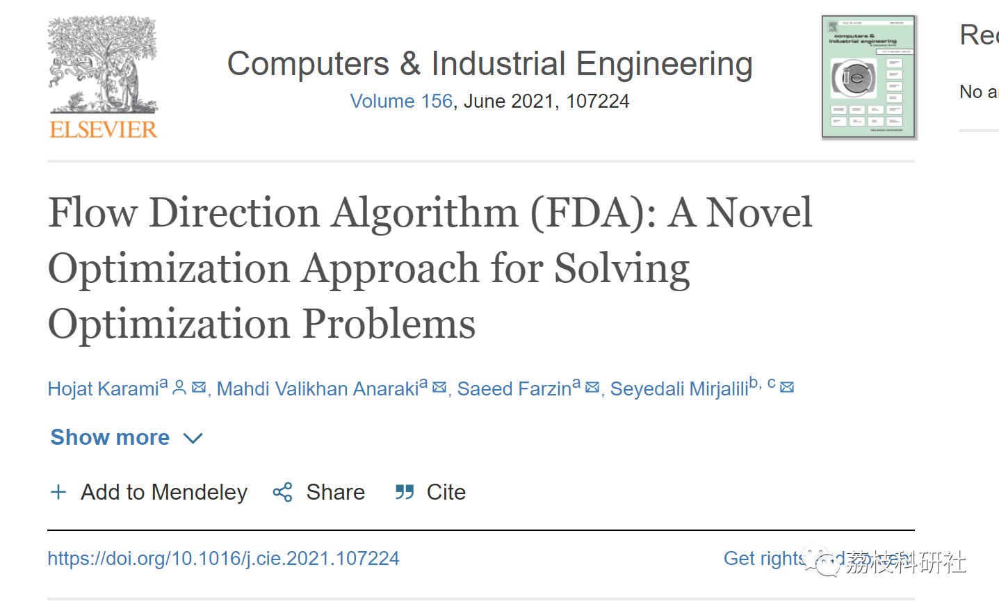
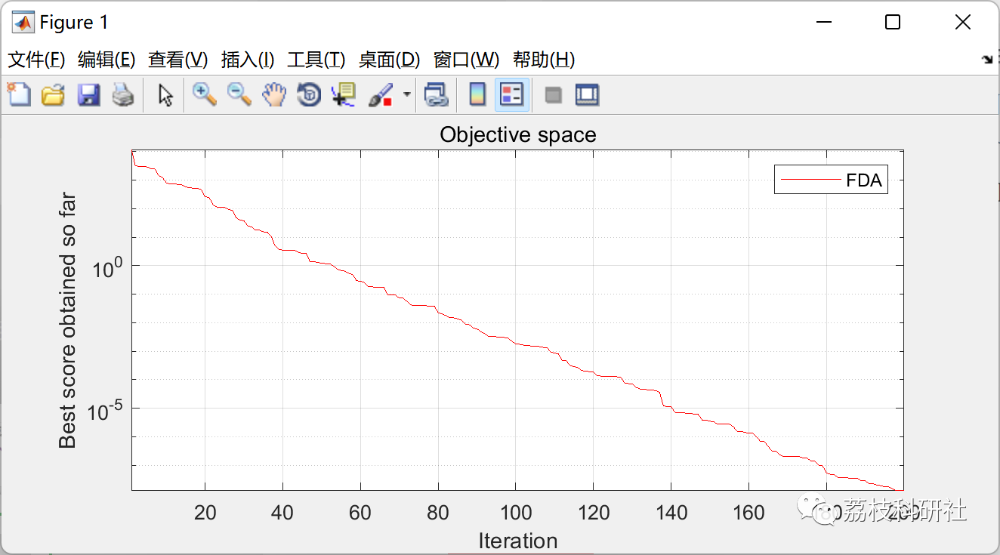
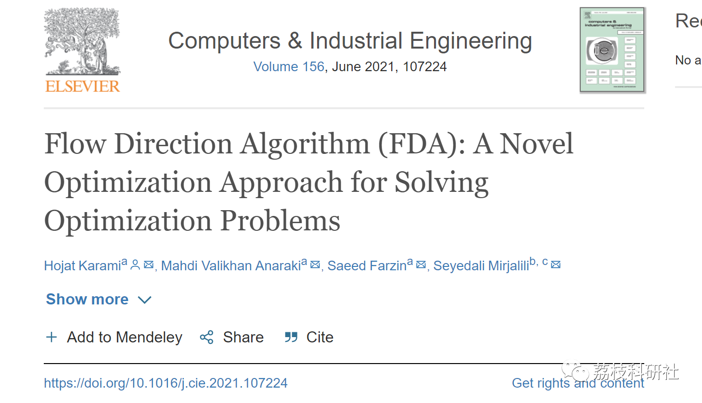

# Flow Algorithm (FDA) (Matlab Code Implementation)

​  
💥💥💥💞💞💞Welcome to this blog.❤️❤️❤️💥💥💥 🏆Blogger's advantages: 🌞🌞🌞Blog content strives to be as thoughtfully crafted as possible.,  Logic is clear. To facilitate readers. ⛳️ Mantra: Those who travel a hundred miles, Half a hundred and ninety. Table of Contents 💥1 Overview📚2 Running Results🎉3 References🌈4 MATLAB Code Implementation 💥1 Overview
Editor
This study aims to propose a new optimization algorithm, called the Flow-Directed Algorithm (FDA), which is a physical-based algorithm. The FDA algorithm simulates the flow direction of the lowest elevation outlet point in a basin. In other words, the flow moves towards the neighbor with the lowest elevation or the best objective function. Considering 13 classical mathematical benchmark functions, 10 new mathematical benchmark functions, and 5 engineering design problems including three-bar truss, tension/compression spring, reducer, gear system, and welded beam design, the proposed algorithm was evaluated. The results of the FDA were compared with other optimization algorithms, demonstrating the outstanding performance of the FDA in solving challenging optimization problems.
📚2 Running results
Editor
Part of the code:
function [Best_fitness,BestX,ConvergenceCurve]=FDA(maxiter,lb,ub,dim,fobj,alpha,beta)  
% Initialize the positions of flows  
flow_x=initialization(alpha,dim,ub,lb);  
neighbor_x=zeros(beta,dim);  
newflow_x=inf(size(flow_x));  
newfitness_flow=inf(size(flow_x,1));  
ConvergenceCurve=zeros(1,maxiter);  
fitness_flow=inf.*ones(alpha,1);  
fitness_neighbor=inf.*ones(beta,1);  
%% calculate fitness function of each flow  
for i=1:alpha  
fitness_flow(i,:)=fobj(flow_x(i,:));%fitness of each flow  
end  
%% sort results and select the best results  
[~,indx]=sort(fitness_flow);  
flow_x=flow_x(indx,:);  
fitness_flow=fitness_flow(indx);  
Best_fitness=fitness_flow(1);  
BestX=flow_x(1,:);  
%% Initialize velocity of flows  
Vmax=0.1*(ub-lb);  
Vmin=-0.1*(ub-lb);  
%% Main loop  
for iter=1:maxiter  
% Update W  
W=(((1-1*iter/maxiter+eps)^(2*randn)).*(rand(1,dim).*iter/maxiter).*rand(1,dim));  
% Update the Position of each flow  
for i=1:alpha  
% Produced the Position of neighborhoods around each flow  
for j=1:beta  
Xrand=lb+rand(1,dim).*(ub-lb);  
delta=W.*(rand*Xrand-rand*flow_x(i,:)).*norm(BestX-flow_x(i,:));  
neighbor_x(j,:)=flow_x(i,:)+randn(1,dim).*delta;  
neighbor_x(j,:)=max(neighbor_x(j,:),lb);  
neighbor_x(j,:)=min(neighbor_x(j,:),ub);  
fitness_neighbor(j)=fobj(neighbor_x(j,:));  
end  
% Sort position of neighborhoods  
[~,indx]=sort(fitness_neighbor);  
% Update position, fitness and velocity of current flow if the fitness of best neighborhood is  
% less than of current flow  
if fitness_neighbor(indx(1))<fitness_flow(i)  
% Calculate slope to neighborhood  
Sf=(fitness_neighbor(indx(1))-fitness_flow(i))./sqrt(norm(neighbor_x(indx(1),:)-flow_x(i,:)));%calculating slope  
% Update velocity of each flow  
V=randn.*(Sf);  
if V<Vmin  
V=-Vmin;  
elseif V>Vmax  
V=-Vmax;  
end  
%Flow moves to best neighborhood  
newflow_x(i,:)=flow_x(i,:)+V.*(neighbor_x(indx(1),:)-flow_x(i,:))./sqrt(norm(neighbor_x(indx(1),:)-flow_x(i,:)));  
else  
%Generate integer random number (r)  
r=randi([1 alpha]);  
% Flow moves to r th flow if the fitness of r th flow is less  
% than current flow  
if fitness_flow(r)<=fitness_flow(i)  
newflow_x(i,:)=flow_x(i,:)+randn(1,dim).*(flow_x(r,:)-flow_x(i,:));  
else  
newflow_x(i,:)=flow_x(i,:)+randn*(BestX-flow_x(i,:));  
end  
end  
% Return back the flows that go beyond the boundaries of the search space  
newflow_x(i,:)=max(newflow_x(i,:),lb);  
newflow_x(i,:)=min(newflow_x(i,:),ub);  
% Calculate fitness function of new flow  
newfitness_flow(i)=fobj(newflow_x(i,:));  
% Update current flow  
if newfitness_flow(i)<fitness_flow(i)  
flow_x(i,:)=newflow_x(i,:);  
fitness_flow(i)=newfitness_flow(i);  
end  
% Update best flow  
if fitness_flow(i)<Best_fitness  
BestX=flow_x(i,:);  
Best_fitness=fitness_flow(i);  
end  
end  
ConvergenceCurve(iter)=Best_fitness;  
disp(['MaxIter= ' ,num2str(iter), 'BestFit= ', num2str(Best_fitness)])%disply results  
end  
end  
🎉3 References
Editor
🌈4 Matlab code implementation

## Images

<!-- PAYMENT_BLOCK -->

## Get this dataset

- Payment link (Stripe): [Buy now](https://buy.stripe.com/3cs8yP7sY87d0vu9AB)
- Payment QR code: 

<!-- /PAYMENT_BLOCK -->
